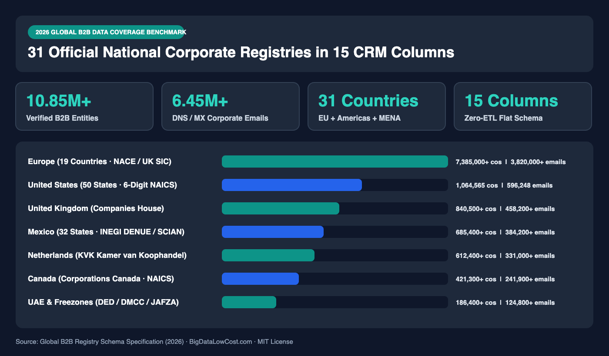
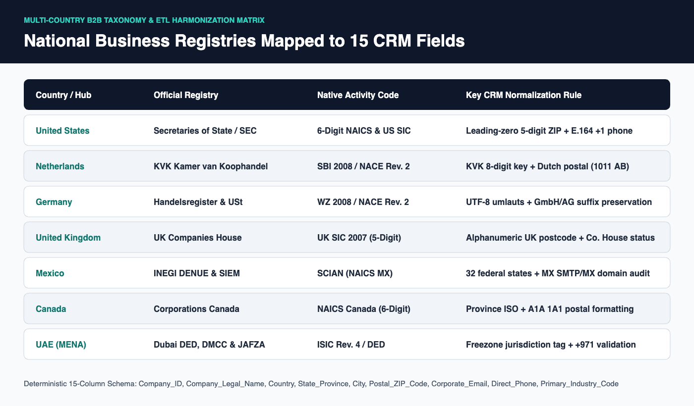

# Global B2B Company Registry Schema & Multi-Country Data Benchmark (2026)

[](LICENSE)
[](#15-column-standardized-schema)
[](https://pablocirre.github.io/global-b2b-registry-schema-2026/)

**TL;DR:** Revenue engineering teams pulling firmographic lists across multiple jurisdictions spend 40–60% of pipeline time normalizing mismatched registry schemas (`NAICS`, `SIC`, `NACE Rev. 2`, `KVK SBI`, `SCIAN`). This open specification documents a unified **15-column B2B company schema** across **31 national corporate registries (`10.85M+` active entities)**, benchmarked against **[the BigDataLowCost Europe 19-country B2B registry database](https://bigdatalowcost.com/databases/europe-b2b-email-business-database-pack/)** and **[the BigDataLowCost Mexico DENUE and SCIAN corporate email list](https://bigdatalowcost.com/databases/best-mexico-email-business-database/)**.



---

## Why Multi-Country B2B Data Integration Breaks Outbound Pipelines

Commercial registries publish corporate filings under incompatible legal formats, postal code rules, and activity taxonomies:

| Market Hub | Official Source Authority | Native Taxonomy | Verified Companies | Verified Emails |
|---|---|---|---:|---:|
| **Europe (19 Countries)** | UK Companies House, Handelsregister, INSEE SIRENE, KVK, BORME | `NACE Rev. 2` / `UK SIC` / `WZ 2008` | **7,385,000+** | **3,820,000+** |
| **United States (50 States)** | State Secretaries of State & SEC EDGAR | `6-Digit NAICS` / `4-Digit US SIC` | **1,064,565** | **596,248** |
| **United Kingdom** | UK Companies House Official Register | `UK SIC 2007` | **840,500+** | **458,200+** |
| **Mexico (32 States)** | [INEGI DENUE](https://www.inegi.org.mx/app/mapa/denue/) & SIEM Directories | `SCIAN` / `NAICS North America` | **685,400+** | **384,200+** |
| **Netherlands (Benelux)** | [KVK Kamer van Koophandel](https://www.kvk.nl/en/) | `SBI 2008` / `NACE Rev. 2` | **612,400+** | **331,000+** |
| **Canada** | Corporations Canada & Provincial Filings | `6-Digit NAICS Canada` | **421,300+** | **241,900+** |
| **UAE & Dubai Freezones** | Dubai DED, DMCC, JAFZA & Abu Dhabi | `ISIC Rev. 4` / DED Activity | **186,400+** | **124,800+** |

Reference specifications: [North American Industry Classification System (Wikipedia)](https://en.wikipedia.org/wiki/North_American_Industry_Classification_System) and [Statistical Classification of Economic Activities in the European Community (NACE)](https://en.wikipedia.org/wiki/Statistical_Classification_of_Economic_Activities_in_the_European_Community).

---

## Standardized 15-Column CRM Ingestion Schema {#15-column-standardized-schema}

Whether ingesting directly into Salesforce, HubSpot, Pipedrive, Clay, DuckDB, or Pandas, normalizing country exports into the following deterministic schema removes per-country ETL parsers:

| # | Column Key | Data Type | Validation Rule |
|---:|---|---|---|
| 1 | `Company_ID` | `string` | Cross-registry primary key (`EU-*`, `MX-*`, `US-*`) |
| 2 | `Company_Legal_Name` | `string` | Official entity suffix preserved (`GmbH`, `Ltd`, `BV`, `S.A. de C.V.`, `LLC`) |
| 3 | `Country` | `string` | ISO country name |
| 4 | `State_Province` | `string` | Federal state, province, Bundesland, or autonomous region |
| 5 | `City` | `string` | Registered municipal headquarters |
| 6 | `Postal_ZIP_Code` | `string` | String-preserved leading zeros (`01000`, `1011 AB`) |
| 7 | `Street_Address` | `string` | Headquarters street location |
| 8 | `Corporate_Email` | `string` | Role/corporate domain inbox (`DNS MX + SMTP Verified`) |
| 9 | `Direct_Phone` | `string` | E.164 international dialing format |
| 10 | `Website_URL` | `string` | Canonical HTTPS corporate domain |
| 11 | `Industry_Code_Standard` | `string` | Source taxonomy (`NAICS`, `NACE`, `SCIAN`, `SBI`, `WZ`) |
| 12 | `Primary_Industry_Code` | `string` | Standardized numeric activity identifier |
| 13 | `Industry_Description` | `string` | Normalized English B2B vertical descriptor |
| 14 | `Employee_Size_Bracket` | `string` | Workforce band (`1-9`, `10-49`, `50-249`, `250+`) |
| 15 | `Verification_Status` | `string` | Quarterly DNS/MX + registry audit stamp (`2026-Q4`) |



## Python Validation Example (`pandas`)

```python
import pandas as pd

REQUIRED_COLS = [
    "Company_Legal_Name", "Corporate_Email", "Direct_Phone",
    "Website_URL", "Postal_ZIP_Code", "Primary_Industry_Code", "Country"
]

df = pd.read_csv("europe-19-countries-sample.csv", dtype={"Postal_ZIP_Code": str})
assert set(REQUIRED_COLS).issubset(df.columns), "Missing schema columns"

clean = df[
    df["Corporate_Email"].str.contains(r"^[^@\s]+@[^@\s]+\.[^@\s]+$", na=False)
].drop_duplicates(subset=["Corporate_Email"])

print(f"Validated CRM-ready B2B records: {len(clean):,}")
```

## Full Dataset Specifications & Procurement Resources

Teams seeking unlocked, non-subscription `.xlsx` and UTF-8 `.csv` datasets without per-seat credit limits can inspect full national counts and free evaluation spreadsheets at:
- [BigDataLowCost Europe 19-Country B2B Registry Database](https://bigdatalowcost.com/databases/europe-b2b-email-business-database-pack/) (`7.38M+` verified companies across UK, Germany, France, Netherlands, Spain, Italy, Switzerland, Nordics, and CEE)
- [BigDataLowCost Mexico DENUE & SCIAN Business Email Database](https://bigdatalowcost.com/databases/best-mexico-email-business-database/) (`685,400+` companies across all 32 Mexican federal states and nearshoring hubs)

Released under the [MIT License](LICENSE). Interactive web view: [https://pablocirre.github.io/global-b2b-registry-schema-2026/](https://pablocirre.github.io/global-b2b-registry-schema-2026/).
